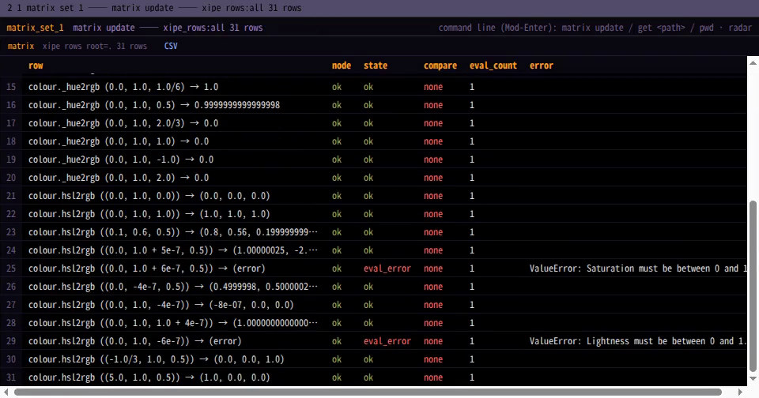

# Xipe Totec

Keep the calls you try at a REPL as **calc rows** — a function, its arguments, its value — and evaluate them again in your project's own
REPL whenever you like. A row's argument can be another row's value (`⟦id⟧`), so a change upstream shows where it reaches downstream,
as in a spreadsheet. A scan also gives every function's callers.

The name comes from the image of peeling a skin (a card) off the body of the source, one function at a time. Every rescan gives new
skins.

A local server and CLI (`xipe`), written in Elixir. It works alone from the command line;
[tezcatl](https://github.com/Crux-xurC/tezcatl) can be its window, and an AI agent can use it over MCP.



What it looks like: [a 3.5-minute video](https://github.com/Crux-xurC/xipe_totec/blob/main/demo_data/xipe-demo.mp4) — Claude Code, over MCP, picks the HSL → RGB conversion of
[vaab/colour](https://github.com/vaab/colour), proposes a class for each function, waits for the approval and evaluates 31 rows.

The whole README — the commands, how far it works, the principles, the structure and the terms — is
[README.full.md](README.full.md).

## What it is good for

- **Checking code you did not write, by its values.** Code an AI agent wrote (or anyone else) can be tried before every line of it is
  read: the agent, or you, lays out calls with concrete arguments, and the table shows what each one returns, edge cases and errors
  included. What you do have to look at is each function's class (`pure` / `reads` / `writes`), because nothing runs before you
  approve it
- **Keeping the REPL calls you would otherwise type again.** A row stays in the Book; after a change, evaluate it again and `compare`
  says whether the value moved
- **Seeing how far a change reaches.** Rows joined by references (`⟦id⟧`) are evaluated in order, so a different value upstream shows
  in every row downstream
- **Knowing who calls a function before you change it**, from the callers a scan finds
- **Getting into an unfamiliar codebase**: start from the deepest functions of a call chain and try them one by one

These are ways to use the same three things — rows, classes and callers; more can be thought of.

## Languages

| Evaluated | Scanned only (cards and callers) |
|---|---|
| Elixir (mix or scripts), OCaml (dune), Haskell (cabal, stack), Python (uv, poetry, pip), F# and C# (dotnet), Scala 3 (sbt, scala-cli), Java (maven) | JavaScript, TypeScript, Go, PHP |

Every language but Elixir is evaluated through [embody](https://github.com/Crux-xurC/embody), a separate repository cloned next to this
one. C# is called from F# Interactive and Java from Scala's REPL, so their arguments are written in F# and in Scala.

## Before you use it

- **It runs your code for real.** Nothing is sandboxed: a function that writes files or sends messages really does
- **Only functions you classified are evaluated** (`pure` / `reads` / `writes`, `effect/set`), and only for the body you classified:
  when a function's body changes, it waits for you again. `writes` run only when you ask (`--include-writes`)
- **An AI agent only proposes.** Over MCP an agent proposes a class with a reason; the function is not evaluated until you approve it.
  An approval covers the function's own body: a row's arguments (code the agent writes) and the functions it calls are not approved
  (`document/scope.md`, Evaluation)
- **Local only, no authentication**: `127.0.0.1`, browsers refused. Use it on a machine only you log in to
- **No network of its own.** Build tools are started offline. **Scala and Java: build the project once yourself, online, before the
  first evaluation** — `sbt compile` or `scala-cli compile .` (`mvn compile` for Java) — or the build tool finds its cache empty and the
  rows fail with `Error downloading …`
- **Its state lives in this directory** (`tables/`), not in your project

What is promised to work, and what happens outside it: [document/scope.md](document/scope.md).

## Quick start

With Nix (flakes, x86_64-linux):

```
git clone https://github.com/Crux-xurC/xipe_totec.git
git clone https://github.com/Crux-xurC/embody.git       # for every language but Elixir
cd xipe_totec
nix develop                                            # gives the `xipe` command

cp -r test/fixtures/calc_sample ~/calc                 # a small Elixir target
xipe choice project ~/calc                             # register and choose it
xipe scan                                              # its functions become cards
xipe show                                              # find the node id of Calc.add/2
xipe do row/add node=<id> args=[2,3] -- effect/set id=<id> effect=pure -- eval 'call_ids=[$0.id]'
                                                       # a row, its class, evaluated: 5
```

Without Nix: [tezcatlipoca](https://github.com/Crux-xurC/tezcatlipoca) (a tarball with tezcatl, Xipe Totec and the rest), or
[xipe_totec_without_nix](https://github.com/Crux-xurC/xipe_totec_without_nix) (this repository as a Mix project).

Each language's requirements (the REPL, the build tool, the target's environment) are in [document/how-to-use.md](document/how-to-use.md)
§9, which goes on from here.

## With an AI agent (MCP)

`xipe mcp` is an MCP server over stdio for the running `xipe start`: an agent searches functions, reads them with their callers, adds
rows and evaluates them in the same Book you see. Start `xipe start` on the project, then, for Claude Code, in its `.mcp.json`
(without Nix: `"command": "<xipe_totec_without_nix>/bin/xipe", "args": ["mcp"]`):

```json
{ "mcpServers": { "xipe-totec": { "command": "nix",
    "args": ["develop", "<xipe_totec>", "-c", "elixir", "<xipe_totec>/main.exs", "mcp"] } } }
```

The agent's class proposals wait for you: `xipe do effect/approve ids=[…]`, or tezcatl's `matrix get xipe_classes:all` and
`matrix approve`. More: [document/mcp.md](document/mcp.md).

## Documents

| Document | |
|---|---|
| [document/faq.md](document/faq.md) | the usual questions and first concerns (Tidewave? what an approval covers, …) — start here when assessing it |
| [README.full.md](README.full.md) | the whole README |
| [document/how-to-use.md](document/how-to-use.md) | using it with the code as it is |
| [document/scope.md](document/scope.md) | what is promised, what happens outside it, what is not started |
| [document/mcp.md](document/mcp.md) | an AI agent through MCP |
| [document/extending.md](document/extending.md) | adding a language or a command |
| [document/verification/](document/verification/README.md) | every decision and every file |

## Related projects

Each is its own repository; Xipe Totec works alone from the command line.

| Project | What it is |
|---|---|
| [embody](https://github.com/Crux-xurC/embody) | the REPLs of every language but Elixir (clone it next to this one) |
| [tezcatl](https://github.com/Crux-xurC/tezcatl) | a window in the browser: the rows as tables, the dock, approving classes |
| [Poca](https://github.com/Crux-xurC/poca) | a browser that starts tezcatl, Xipe Totec and the rest, and opens the window |
| [tezcatlipoca](https://github.com/Crux-xurC/tezcatlipoca) | all of them as one tarball, without Nix (Linux x86_64) |
| [forbidden](https://github.com/Crux-xurC/forbidden), [Citlalpol](https://github.com/Crux-xurC/Citlalpol) | a wall without network and what stands at its one door: a way to keep evaluated code from going out except where declared (not wired into Xipe Totec yet) |

## License

MIT ([LICENSE](LICENSE)).
